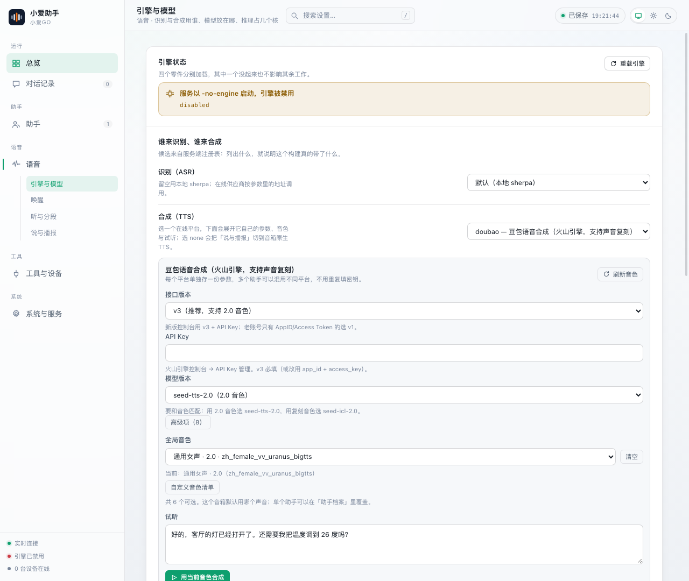

<p align="center">
  
</p>

<h1 align="center">小爱GO</h1>

<p align="center">把闲置的小爱音箱，变成你自己的 AI 语音助手</p>

<p align="center">
  <a href="https://github.com/aidevjoe/xiaoai-go/actions/workflows/ci.yml"></a>
  <a href="https://github.com/aidevjoe/xiaoai-go/pkgs/container/xiaoai-go"></a>
  
  <a href="LICENSE"></a>
</p>

---

## 这是什么

小爱音箱的语音助手是封闭的：唤醒词改不了、答什么由厂商决定、也接不进自己的模型。
但它本身是台不错的硬件——麦克风阵列、喇叭、常年在线的电源。

**小爱GO 把「耳朵和嘴」留下，把「大脑」换成你自己的**：

```
小爱音箱 (刷 open-xiaoai 固件)        你的服务器 / NAS
┌──────────────────────────┐        ┌────────────────────────────────┐
│ 麦克风 ──► 唤醒词检测      │  ws    │  ASR ──► 大模型 ──► TTS        │
│ 喇叭   ◄── PCM 音频       │◄──────►│  (本地/云端)  (可自选平台/音色) │
└──────────────────────────┘        └────────────────────────────────┘
```

唤醒、识别、推理、合成都跑在你自己的机器上；除了你主动选择的云端服务（模型 API、
云端 TTS、搜索），没有任何数据外发。

## 特性

| | |
| --- | --- |
| **全链路自托管** | 唤醒 → 识别 → 大模型 → 合成，一条链路都在你的服务器上 |
| **本地唤醒** | KWS（sherpa-onnx zipformer）本地跑，不联网也能喊醒 |
| **多助手** | 不同唤醒词 → 不同模型 / 提示词 / 工具范围 / **音色**（喊"小美"温柔女声，喊"老张"浑厚男声） |
| **多 TTS，可热切** | 豆包（支持**声音复刻**）、Edge（免费、300+ 音色）、本地 sherpa，运行时切换不用重启 |
| **Home Assistant** | 控灯、调温、查状态；也能把设备状态注入提示词，模型不用多跑一轮工具 |
| **提示词预取** | 时间 / 天气 / 联网搜索并行预取后拼进上下文，固定 1.5s 预算 |
| **音箱端 3MB** | 纯 Go 静态编译（-s -w），无依赖，兼容音箱上的 Linux 4.9 |

## 快速开始

### 0. 你需要准备

- 一台**已刷 [open-xiaoai](https://github.com/idootop/open-xiaoai) 固件**的小爱音箱（本项目在 LX06 上实测），且能 SSH 登录
- 一台常年开机的 Linux 机器（NAS / 小主机 / 树莓派都行），装了 Docker
- 一个模型 API（DeepSeek / Kimi / OpenAI 兼容的任意端点）

### 1. 拿模型

服务端启动时按目录约定自动发现模型。一条命令下载最小四件套（下载约 280MB，解开约 490MB），不用 clone 仓库：

```bash
curl -sSfL https://raw.githubusercontent.com/aidevjoe/xiaoai-go/main/deploy/scripts/fetch-models.sh \
  | sh -s -- ~/xiaoai/models
```

只用云端 TTS（豆包 / Edge）的话，把本地合成模型跳过，省 200MB 磁盘：

```bash
curl -sSfL https://raw.githubusercontent.com/aidevjoe/xiaoai-go/main/deploy/scripts/fetch-models.sh \
  | SKIP_TTS=1 sh -s -- ~/xiaoai/models
```

国内直连 GitHub 慢，可以套个加速前缀：`... | PROXY=https://ghproxy.net/ sh -s -- ~/xiaoai/models`

```
models/
├── silero_vad.onnx                                  # VAD，必需
├── sherpa-onnx-sense-voice-...-int8-2024-07-17/     # ASR（中文识别）
├── sherpa-onnx-kws-zipformer-.../                   # KWS（唤醒词）
└── vits-icefall-zh-aishell3/                        # 本地 TTS（可选，用了云端就不需要）
```

脚本可以反复执行，已有文件会跳过。模型缺失不会让服务崩掉：后台会显示哪个零件没加载，其余照常工作。

### 2. 起服务端

```bash
mkdir -p ~/xiaoai/{models,data}

docker run -d --name xiaoai-server --restart unless-stopped \
  -p 4399:4399 -p 8080:8080 \
  -v ~/xiaoai/models:/models:ro \
  -v ~/xiaoai/data:/data \
  -e TZ=Asia/Shanghai \
  ghcr.io/aidevjoe/xiaoai-go:latest
```

> `4399` 是设备面（音箱连它），`8080` 是管理后台。
> 不想用镜像也可以 `git clone` 后 `NAS_HOST=... NAS_DIR=... sh deploy/scripts/deploy-server.sh`，在目标机上就地编译。

### 3. 装音箱端

先 SSH 进音箱（已刷 open-xiaoai 固件），然后在**音箱上**跑一条命令：

```bash
ssh -o HostKeyAlgorithms=+ssh-rsa root@192.168.1.50

# 进了音箱再执行，地址换成你的服务端
curl -sSfL https://raw.githubusercontent.com/aidevjoe/xiaoai-go/main/deploy/scripts/install-client.sh \
  | SERVER=ws://192.168.1.10:4399/ws sh
```

脚本会从 Release 拉 armv7 客户端（约 3MB）、探测可用的录音设备、写守护脚本并设成开机自启。
之后换服务端地址只要改音箱上的 `/data/xiaoai/server.txt`，不用重装。

不想 SSH 也可以在自己电脑上远程装（需要 `sshpass`）：

```bash
curl -sSfL -o install-client.sh https://raw.githubusercontent.com/aidevjoe/xiaoai-go/main/deploy/scripts/install-client.sh

DEV=192.168.1.50 PASS='音箱root密码' SERVER=ws://192.168.1.10:4399/ws sh install-client.sh
```

> 自己编译也行：`make client` 之后加 `BIN=dist/xiaoai-client-armv7`，就不走 Release 下载了。

### 4. 打开后台配置

`http://你的服务器:8080/` → 填模型地址 / Key / 唤醒词 → 喊一声试试。



## 语音合成：三种来源

| 平台 | 费用 | 音色 | 特点 |
| --- | --- | --- | --- |
| **豆包**（火山引擎） | 按字符计费 | 2.0 音色 + **声音复刻** | 中文自然度最好，300~800ms |
| **Edge** | 免费 | 在线拉全量，300+ | 无需密钥，首次约 1~2s，会按出口 IP 限流 |
| **本地 sherpa** | 免费 | 由模型决定 | 不联网，8k/22k，语速可调 |

- **全局音色** 在「语音 · 引擎与模型」里选，**单个助手**可以在档案里覆盖（只换音色不用换平台）。
- 音色和语速是**请求参数**而不是实例状态，所以两个助手同时说话不会串音。
- 唤醒应答这类固定短句有缓存（按音色分键），第二次播放零延迟。

### 声音复刻（豆包）

1. 火山引擎控制台开通"声音复刻"，拿一个音色槽位号 `S_xxxxxxxx`
2. 后台上传 10~30 秒干净人声 → 提交训练
3. 训练完成（10 秒~1 分钟）后点「用这个音色」，后台会自动把模型版本切到 `seed-icl-2.0`

> 复刻音色必须配 `seed-icl-2.0`，留在 `seed-tts-2.0` 会报"音色不存在"。

## 配置

全部配置在 `data/settings.json`，分六段（后台按页面分组，一般不用手改）：

| 段 | 管什么 |
| --- | --- |
| `server` | 后台标题、设备鉴权令牌、对话记录保留条数、是否存原始录音 |
| `engine` | 模型路径、线程数、VAD 阈值、**ASR/TTS 供应商**、每个平台的参数 |
| `voice` | 语速、声音来源（本地合成 / 音箱原生）、提示音、固定应答 |
| `dialog` | 退出词、静音断句、前置缓冲、上下文保鲜期、工具轮数 |
| `tools` | Home Assistant、联网搜索、天气来源、自定义 HTTP 工具 |
| `profiles` | 助手档案：唤醒词 → 模型 + 提示词 + 工具白名单 + 音色 |

配置文件里有 API Key，`.data/` 已在 `.gitignore` 里，**不要提交**。

## 常见问题

**识别总丢开头几个字**
调大「听与分段 → 前置缓冲（pre_roll_ms）」。VAD 在嘈杂环境要 400~600ms 才确认人声，
缓冲不够就会把开头吃掉。默认 700ms。

**说完话很久才出声**
瓶颈通常在模型首字延迟，不在 TTS。后台「对话记录」里有分段耗时（首字 / 整轮），
先看是"等模型"还是"等合成"。

**服务端 CPU 吃满**
sherpa 的 ASR/TTS 是 CPU 推理。把「推理线程」调到 2~4 之间通常性价比最高；
只用云端 TTS 的话可以直接把本地 TTS 关掉（选 `none`）。

**后台打不开 / 空白**
确认 `8080` 映射到了容器；容器日志里应有 `管理面监听 :8080`。

## 开发

```bash
make help        # 看所有目标
make test        # 单测
make lint        # go vet + gofmt 检查
make ui          # 重建前端（产物落在 internal/server/web/dist，需一并提交）
make dev-run     # 本机跑服务端（-no-engine，不需要模型，能改后台和对话逻辑）
make docker      # 本地构建镜像
```

服务端需要 cgo（sherpa-onnx 是 C++ 库），**在 macOS 上交叉编译会段错误**——
正式构建请用容器：`make docker` 或在目标机上跑 `deploy/scripts/deploy-server.sh`。

目录结构：

```
cmd/client        音箱端（CGO_ENABLED=0，armv7）
cmd/server        服务端（cgo）
cmd/fakeclient    模拟音箱，本机联调
internal/proto    协议 v2：JSON 控制帧 + 24B 二进制音频帧
internal/client   采集、播放、重连、设备信息
internal/server   hub（设备会话）/ audio（VAD·ASR·TTS·KWS）/ dialog / llm / tools / store
  └─ audio/tts_*.go   各 TTS 平台实现（一个平台一个文件）
ui/               管理后台（Vue 3 + Vite）
deploy/           Dockerfile 与脚本（模型下载 / 客户端安装 / 远程部署）
docs/             截图等素材
```

### 加一个新的 TTS 平台

新建一个文件即可，不用改核心、配置结构或前端：

```go
func init() {
    RegisterTTS(TTSProvider{
        Name: "myservice", Desc: "我的在线语音", Local: false,
        Fields: []Field{{Key: "api_key", Label: "API Key", Kind: "password", Required: true}},
        Voices: []Voice{{ID: "v1", Name: "通用女声", Lang: "zh"}},
        New:    func(o TTSOptions) (Synthesizer, error) { return newMyService(o.Params) },
    })
}
```

后台的配置表单、音色下拉、试听面板会自动出现。想照着现成的写，看
[`tts_edge.go`](internal/server/audio/tts_edge.go)（在线拉音色）或
[`tts_doubao.go`](internal/server/audio/tts_doubao.go)（流式 + 声音复刻）。

## 实测（4 核 CPU，LX06）

| 指标 | 数值 | 说明 |
| --- | --- | --- |
| 唤醒 → 开始播应答 | 3~7ms | KWS 命中后立刻出声 |
| 首字延迟（假模型） | 2~11ms | 隔离模型耗时，只看链路 |
| 单轮总耗时（假模型） | 300~880ms | 含 2 句合成 + 104 帧音频下发 |
| 模型首字（deepseek-flash） | 2.1~2.9s | 主要瓶颈，不是 TTS |
| 豆包 TTS 单句 | 300~800ms | 固定应答命中缓存后为 0 |
| 客户端体积 | 2.9MB | 纯 Go 静态链接，`-s -w` 后 |


## 致谢

- [open-xiaoai](https://github.com/idootop/open-xiaoai) — 音箱固件与刷机方案
- [sherpa-onnx](https://github.com/k2-fsa/sherpa-onnx) — VAD / ASR / TTS / KWS 推理
- [coder/websocket](https://github.com/coder/websocket)、[go-mp3](https://github.com/hajimehoshi/go-mp3)
-  [open-xiaoai-bridge](https://github.com/coderzc/open-xiaoai-bridge)

## License

[MIT](LICENSE)。本项目与小米 / 火山引擎 / 微软均无关联，仅供个人学习与自用。
